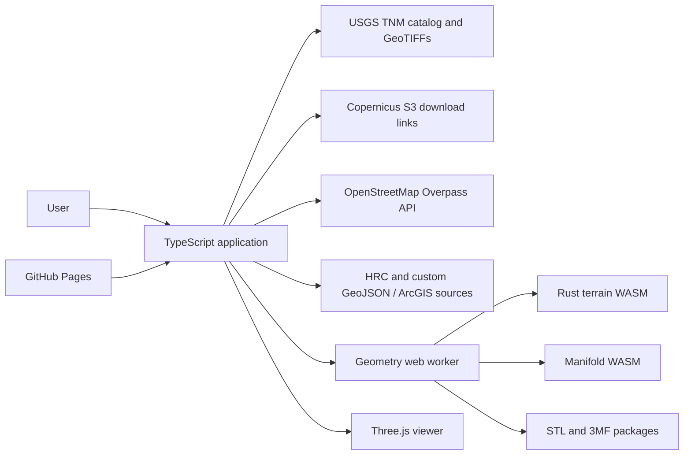

# Contour Workbench architecture

Status: implemented architecture, October 2026.

Fit calibration is available from the landing page without loading terrain, using default settings, and from Print setup using current project settings. Both entry points prompt for standard, Bambu Studio, or PrusaSlicer 3MF (defaulting to standard 3MF), or an STL ZIP. The geometry worker generates a connected fit-pocket base with a real Mt. Hood Meadows terrain patch (USGS 3DEP, downsampled from the bundled preset to a 65 × 65 grid in calibration-terrain.json). A private Rust terrain session preserves the active project. The terrain is normalized across the original 100 × 38 mm coupon footprint with 1.2 mm relief above a 2 mm minimum surface. All four fit pockets cut directly into the terrain down to a shared 1 mm floor; a flat rear strip retains readable numbered labels. No separate terrain extension increases the print area. The worker passes its validated meshes to the shared 3MF packager; each single-file 3MF embeds the clearance manifest and instructions under Metadata. Bambu fit tests use a single plate with spaced, grounded objects and explicit by-object sequencing on the mixed-filament plate. The shared Bambu encoder supplies the Application compatibility marker required by the native importer while retaining Contour Workbench attribution, plus a per-object variable layer-height profile.

## Purpose

Contour Workbench is a static, client-side application for designing printable terrain models. It combines elevation rasters and map features, previews the effective design in Three.js, and creates validated terrain, insert, and carved geometry without a backend.

The browser is the trust boundary for uploaded files and downloaded models. Remote services provide source data only; project editing and mesh generation stay on the user's device.

## System context

GitHub Pages serves HTML, JavaScript, WebAssembly, screenshots, and preset packs. There is no runtime application server.

## Components

### Rust geometry core

`crates/terrain-core` owns rules that must be deterministic and portable:

- Settings and geographic bounds validation.
- Elevation-grid sampling and geographic-to-model layout.
- OSM and GeoJSON classification and normalization.
- Full-resolution and adaptive terrain triangulation. Full-detail grid faces are emitted in 128 by 128-cell tiles that share global seam vertices; adaptive builds skip allocating the obsolete full-detail face list.
- Polygon clipping for arbitrary terrain extents.
- Preview overlays, V-carve geometry, separate insert prisms, and direct feature-aware pocket and zone-floor surfaces.
- Removal of enclosed terrain pins below the nozzle-derived printable width.
- Copernicus tile URL and Overpass query construction.
- Closed, consistently oriented mesh validation.

Geographic positions are `[longitude, latitude]` in decimal degrees. Elevations are meters at the source boundary. Generated model coordinates and print settings are millimeters unless a name explicitly ends in `_m` or `_deg`.

### WASM boundary

`crates/terrain-wasm` exposes a `TerrainSession`. The session parses, validates, and retains one elevation grid. Terrain, overlay, and plan calls send only changing settings, features, and layout data.

Geometry crosses the boundary in a versioned `CWB1` binary packet:

1. Four-byte magic value.
2. Little-endian metadata byte length and mesh count.
3. Position and index counts for every mesh.
4. UTF-8 JSON metadata.
5. Padding to a four-byte boundary.
6. Per-mesh `f32` XYZ positions followed by `u32` triangle indices.

The TypeScript decoder returns typed-array views over the packet when alignment allows. This avoids large JSON number arrays and repeated elevation-grid parsing. Printable plans stay in the Rust session. The worker first takes ownership of the final planned terrain mesh, then pulls bounded V-carve packets and insert packets. Every take operation replaces the Rust vectors with empty vectors before encoding, so source allocations are released as soon as ownership crosses the boundary instead of remaining duplicated in the pending plan.

### Browser application

`web/src/main.ts` composes the UI, project state, persistence, source loading, and worker requests. Supporting modules isolate major browser responsibilities:

- `app-shell.ts`: static controls, dialogs, and viewport hosts.
- `providers.ts` and `provider-registry.ts`: raster windows and mosaics, provider selection, USGS/Copernicus catalogs, persistent response caching, and bounded Overpass mirror failover.
- `feature-sources.ts`: curated Overpass, HRC, USFS, NPS, BLM, Washington RCO, and OpenSkiMap entries, validated custom HTTPS endpoints, browser-local library preferences, bounded GeoJSON downloads, complete ArcGIS object-ID batching, WGS84 validation, and source-specific refresh merging. `feature-source-panel.ts` owns the library controls and shares their selection with the new-landscape wizard. Explicit feature-class and name-field mappings are applied by the Rust normalizer; they do not change the saved Feature contract.
- `extent-map.ts` and `extent-shapes.ts`: slippy-map drawing and editable shapes.
- `gpx.ts`: validates uploaded GPX XML and converts each track or route into an enabled trail feature with a unique import ID, its GPX name (or filename fallback), and separate lines for track segments. Multiple files append atomically to the active project; imported features use the existing tree controls, terrain clipping, preview, generation, and project persistence. GPX elevation is ignored in favor of terrain elevation; standalone waypoints are not imported.
- `gpx-placement.ts` classifies full line segments against the terrain grid and optional concave boundary. Feature-tree labels distinguish inside, partial, and outside tracks. Zoom shows a temporary unclipped geographic footprint above the terrain; it never enters exported geometry. Fit model clears the guide.
- `filaments.ts` resolves a deterministic color per physical slot. Print-together previews and 3MF exporters share this palette. Legacy conflicting assignments are called out in Print Setup; users can choose distinct slots or normalize shared colors. Changing a slot's color updates its assigned classes together. Separate printing retains class colors.
- `viewer.ts`: Three.js terrain, feature overlays, topographic ground imagery, selection, and review. The floor and topo imagery render first in fixed background order without depth tests or writes; terrain and feature meshes retain normal depth occlusion. This avoids depth fighting between the closely spaced ground planes while panning.
- `annotation-editor.ts` and `annotations.ts`: text/PNG authoring and printable geometry.
- `presets.ts`: static landing catalog and prebuilt mesh packs.
- `three-mf.ts` and `three-mf-validation.ts`: portable, Bambu Studio, PrusaSlicer, and service 3MF packages plus mesh, OPC-part, XML, identifier, and build-reference validation.
- `export-client.ts`, `export-worker.ts`, and `export-formats.ts`: one disposable final-export worker, compact transferable mesh copies, target-specific encoding, and strict worker termination.
- `project-files.ts`: filesystem-safe project names, browser downloads, and upload limits.
- `engine-contract.ts` and `client.ts`: a discriminated request/result map, structured progress, and request cancellation for the geometry worker.
- `persistent-cache.ts`: IndexedDB source-data caching with an in-memory fallback and expiration policy.
- `project-store.ts`: durable local project metadata, state, terrain, and generated thumbnails.
- `serialized-contract.ts`: compile-time TypeScript parity with the Rust serialization manifest.

A saved schema-version-2 project contains the elevation grid, provenance, features, annotations, editable extent state, and print settings. It does not depend on a service remaining available after save. Editable file export uses this same schema; local projects split the state and elevation records so frequent edits do not rewrite the large raster.

The viewer computes a standard presentation pose from the highest surface vertex. It places that point toward the back of the scene and frames the terrain from an oblique elevation. Thumbnail rendering uses the same pose in an offscreen render target, without moving the user's active camera.

GeoTIFF, Manifold, and 3MF modules are dynamically imported at their first use. The landing and preset-editing path therefore avoids parsing those heavy implementations until a user downloads terrain, generates printable geometry, or exports 3MF.

### Geometry worker

`web/src/worker.ts` keeps expensive and WASM-backed work off the UI thread. It owns:

- The persistent Rust `TerrainSession`.
- The current terrain mesh and settings.
- Direct Rust terrain pockets, remaining Manifold operations for V-carves and annotations, streamed insert batches, and explicit object deletion through `manifold-adapter.ts`.
- Full edge validation and bounded repair for independent parts. Large terrain exported directly from a successful Manifold solid receives finite-coordinate and triangle-index validation without allocating a second three-edges-per-triangle table.
- A pre-allocation memory estimate that chooses bounded adaptive terrain detail when automatic full detail would exceed the browser-derived build budget.
- Cooperative cancellation checkpoints between V-carve groups, annotations, and insert operations, with forced worker replacement if native WASM work does not yield promptly.
- Calibration geometry, preset packs, and generation results. Final archive encoding is isolated in a disposable export worker.

Changing visibility, treatment, width, or carve depth rebuilds overlays or the final plan without rebuilding terrain. Base-thickness edits shift cached terrain vertices without rebuilding source terrain. A new grid or terrain build replaces the Rust session.

The worker retains its terrain buffer. Responses that cross the worker boundary receive a copy, because transferring the retained buffer would detach it and corrupt later generation. Worker requests and responses are exhaustively typed by operation; adding an operation requires updating the shared map rather than passing an untyped string and payload.

### Manifold compatibility

Manifold performs final solid unions, differences, intersections, taper layers, and annotation booleans. The project pins `manifold-3d` 3.5.4, and dependency upgrades must pass both preset generation tests before changing the pin.

Manifold mesh exports can contain multiple property vertices for one topological vertex. `manifold-adapter.ts` resolves the merge-vector union relation, compacts referenced vertices into typed arrays, and validates directed edges through a sorted numeric buffer. This avoids the string-key maps and boxed number arrays that previously produced large transient allocations on full-resolution terrain. Native topology is preferred over coordinate welding because distinct vertices may be nearly coincident; bounded coordinate welding remains a fallback for malformed exports.

Insert pockets preserve class priority inside Rust. Equal-height pocket regions are unioned, deeper regions claim overlaps, and a constrained terrain triangulation emits the original surface, pocket floors, shared bottom, outer walls, and vertical feature interfaces as one validated mesh. A deterministic bounding-box sweep routes different-height overlaps or shared boundaries to bounded pocket cutters before constrained triangulation, avoiding a known failed-build path on complex presets. Direct pocket boundaries (including holes) and the model outline are sampled at elevation-grid crossings and at most 0.6 mm apart before linework normalization. Each sample receives bilinearly interpolated source elevation; terrain and pocket walls share these constrained vertices so long cut edges cannot bridge over intervening relief, even with adaptive terrain simplification. Touching linework for remaining direct pockets is normalized before the full terrain load. If another pathological junction still fails two-manifold validation, Rust emits the established bounded pocket cutters instead of returning unsafe geometry. Feature patches window the elevation grid to local bounds. V-carves remain bounded class-preserving cutter packets because their sloped profiles still use Manifold subtraction. Each transferred terrain, cutter, and insert mesh is removed from the pending Rust plan as its packet is produced.

The working terrain solid is deleted immediately after export; only then is the extra conformal-terrain solid created for insert fitting. Conformal fitting shifts that temporary solid by each piece's effective signed relative-height offset, replacing it when the offset changes so only one shifted copy is retained. For terrain above one million preview triangles, Three.js releases design geometry and keeps the topo surface visible during generation. These lifetime rules reduce the shared WebContent-process peak while preserving class order and Boolean meaning. Temporary Manifold and CrossSection objects must be deleted in every success and failure path.

## Data flows

### New project

1. The user draws or edits a geographic boundary. Rounded corners are tessellated against the final print scale with a 0.05 mm maximum chord error and a bounded vertex budget.
2. The viewer immediately derives the same print-bed layout used by Rust, shows the USGS topo map (OpenTopoMap internationally), and draws the selected boundary while source data loads.
3. Source policy estimates raster sample count and chooses 10 m, 30 m, or 90 m data for Auto. The browser checks IndexedDB before resolving or downloading tiles.
4. As soon as elevation is available, Rust builds terrain and the viewer replaces the flat map footprint with the fitted terrain mesh.
5. As soon as terrain is ready, the UI restores editing controls and requests supported paths and zones from Overpass in the background. Each attempt has its own abort deadline; transient HTTP/network/runtime-timeout failures rotate through configured mirrors with capped jittered backoff and Retry-After support. A hard attempt/time budget settles the task, successful responses are deduplicated and cached for one day, and project switches cancel stale work. Exhaustion leaves terrain intact and exposes an explicit retry action.
6. Rust normalizes classifications and builds preview overlays. Three.js adds them without rebuilding or hiding the terrain.
7. Feature controls remain editable throughout the completed design preview.

### Feature source library

The Features panel and new-landscape wizard share a source selector. OpenStreetMap
remains the default and retains its existing cache, mirror failover, retry, and
winter behavior. Winter landscape creation explicitly uses Overpass. HRC queries
the county public trail layer within the terrain bounds, with automatic county
classification excluding closed/future trails. Sources load one at a time; users
can combine sources by loading each into the same model.

USFS, NPS, BLM public trails, and Washington RCO use official ArcGIS layers with
the same terrain-envelope queries and complete ID batching as HRC. Each entry
maps the provider's exact trail-name field and explicitly imports trails. BLM
uses the managed-for-public layer, excluding the separate unassessed layer;
Washington uses the current RCO public view's Trails layer, not trailhead points.
Curated descriptions explain coverage beside the selector. These public trail
layers may overlap each other and Overpass; source snapshots remain independent.

OpenSkiMap's public `/features.geojson?bbox=…&types=run,lift` endpoint supplies
terrain-bounded ski GeoJSON without a backend or worldwide download. The browser
enforces the API's 1,000 km² bounding-box limit using its equirectangular formula.
Rust classifies active OpenSkiData run/lift properties and excludes non-ski uses
and inactive features. Browser identity mapping prefers sorted upstream sources;
ambiguous split-feature groups append the content ID. This preserves ordinary
refresh edits but cannot guarantee continuity when split features change. Source
credits travel in `tags.contour_source.attribution` and export attribution files.

Custom library entries (name, HTTPS URL, feature class, optional name field) live
under `contour-feature-sources-v1` in localStorage. Entries can be edited or removed;
removing one does not delete imported model geometry. Storage failure is reported
instead of claiming a definition was saved. Library preferences are separate from
saved projects. Projects embed downloaded geometry and source provenance inside
the existing feature `tags.contour_source` object, so reopening never depends on
network availability or the source library.

GeoJSON endpoints can use `{bbox}` for west,south,east,north. Complete files are
also supported and filtered by geometry bounds before Rust clips them to the
model outline. ArcGIS FeatureServer/MapServer layer URLs (including query URLs)
are detected automatically; the loader requests matching object IDs and downloads
verified batches of 200 in EPSG:4326. Partial responses fail before any project
mutation. Downloads omit browser credentials, require browser CORS access, and
have a 60-second deadline, 50 MB response budget, 20,000-feature limit, and
500,000-coordinate limit. Invalid/projected coordinates, duplicate IDs, unsupported
geometry collections, and known pagination/truncation indicators produce actionable
errors. Point features and null geometries are not printable and are skipped in
plain GeoJSON files; ArcGIS layers must return complete line/polygon batches.

Endpoint loads use stable source-prefixed feature IDs (remote IDs when available,
otherwise a canonical geometry/properties SHA-256 digest). HRC retains the existing
`county-trail:<OBJECTID>` identifiers so refreshing the bundled Post Canyon model
does not duplicate its trails. A successful refresh replaces that source's prior
snapshot, removes disappeared records, and preserves matching visibility,
treatment, surface, width, and insert depth overrides. Other sources and uploads
remain intact. Downloads are fresh on each explicit load; only Overpass uses its
existing persistent cache. The shared cancellation controller and serial/project
guards reject late results after cancellation, navigation, or project replacement.

### Preset project

1. The landing catalog loads a compressed `.cwpack`.
2. The app displays its prebuilt terrain immediately, then adds the linked overlays on the following rendered frame.
3. Overlay identifiers are checked against project feature identifiers.
4. The worker hydrates a Rust session in the background for subsequent edits and generation.
5. Opening a preset remains ephemeral. Its first edit forks it into a new local project identifier and starts autosave.

Post Canyon's trail snapshot comes from Hood River County's public recreation-trail
FeatureServer layer 134. The raw WGS84 GeoJSON lives in
`tests/resources/post_canyon.geojson`; the integration fixture retains its separate
boundary, roads, streams, and elevation grid. Rust recognizes the county's
`Trail_Name` and full `Name` fields and excludes closed/future trails. The preset
uses stable `county-trail:<OBJECTID>` identifiers and regenerated overlay meshes;
its catalog revision must advance with each refresh to invalidate cached bundles.
Download details are recorded in `tests/resources/README.md`.

### Local project sessions

1. The first meaningful edit to a preset, or creation/import of a new design, assigns a UUID. Merely viewing a preset creates no local record.
2. A short debounce writes project state and metadata to IndexedDB. The elevation grid has a separate record and is rewritten only when its identity changes.
3. After the scene settles, Three.js renders a 640 × 360 WebP thumbnail from the standard presentation pose. The landing page resolves thumbnail blobs to temporary object URLs.
4. Returning users can open, rename, duplicate, export, or delete recent projects from the landing page. Opening restores the complete saved project and terrain without fetching source services.
5. IndexedDB failures fall back to memory for the current visit. The app requests persistent browser storage after the first local save when the browser exposes that capability.

### Printable generation

1. Before final geometry allocation, the worker estimates the build peak from source samples, preview triangles, and enabled features. Automatic full detail is replaced with a bounded sampled-error target when the estimate exceeds 72 percent of the browser-derived budget; an explicit user detail target is preserved.
2. Rust constructs insert bodies and the final terrain directly. Constrained surface regions share canonical XY interface coordinates, while each top region owns the height needed for terrain, pocket floors, and vertical walls.
3. The worker takes and releases that terrain allocation, then applies remaining V-carve and annotation operations through Manifold. Plans whose direct pocket junctions fail topology validation include bounded fallback pocket cutters in the same streamed cutter path.
4. Rust streams bounded insert packets. Separate mode can taper them; print-together mode keeps exact interface coordinates and zero fit clearance. Conformal intersections use a separately scoped shifted preview-terrain solid.
5. Independent pieces receive full edge validation. The direct terrain is validated by Rust before transfer and Manifold validates any subsequent solid operation.
6. Separate mode enters Review with the terrain and linked insert pieces. Print-together uses `painted-surface.ts` to union temporary zero-clearance regions into one exterior mesh. Manifold original-face provenance becomes a compact per-triangle material array; internal partition faces are discarded. Temporary construction depth is fixed independently of insert-depth settings, and a buried 1 µm overlap prevents Float32 round trips from leaving disconnected floor shells. Raised, recessed, level, and conformal surface shapes remain geometry. The persistent interactive worker retains preview state; final archive encoding uses a separate disposable worker.

### Download

The UI copies generated meshes into compact typed arrays and transfers ownership to a newly created export worker. The worker encodes one selected target, transfers the completed bytes back, and closes. The client also terminates it after success, failure, or cancellation. This keeps archive strings, texture data, and duplicate geometry out of the persistent preview/generation worker.

- STL creates a ZIP with terrain and insert files, project data, origins, validation, and attribution.
- The download dialog offers STL parts or 3MF, with standard, Bambu Studio, and PrusaSlicer choices nested under 3MF. Manufacturing mode is chosen before generation and is independent of file format.
- STL bundles use local insert coordinates for separate assembly. Print-together exports only the exterior shape; STL cannot retain painted colors, which the download dialog and bundle README explain.
- Standard and PrusaSlicer 3MF place separate inserts flat and apart as independent build objects for the slicer to arrange; print-together retains assembly coordinates. PrusaSlicer groups print-together parts into one build object and uses per-object adaptive layer profiles for separate printing. Both modes include a complete slot-indexed filament/extruder palette and nozzle array, plus native Slic3r_PE_model.config volume assignments and triangle ranges. The PrusaSlicer 2.x compatibility marker selects the legacy project reader; Designer retains Contour Workbench attribution. Printer-specific packing remains Bambu-only; Prusa users arrange parts for their selected printer.
- Bambu 3MF includes required filament palettes and installed printer/process/PLA preset references plus explicit difference lists. This avoids the native importer dereferencing a missing palette before defaults are applied, and lets omitted machine G-code, temperatures, and other settings inherit the selected presets. Only intentional process/color overrides are embedded. Users select their actual filament in the slicer.
- Bambu Studio print-together 3MF contains one painted mesh with native `paint_color` triangle assignments and the filament palette. PrusaSlicer uses native `mmu_segmentation` assignments; standard 3MF uses triangle base-material colors. Only the exterior is specified: slicers determine material penetration, walls, and infill. Review renders the same face-material array, and the disposable export worker receives a separate transferable copy.
- Legacy service encoders remain internal; service-specific formats are no longer presented in the download dialog.
- Separate manufacturing uses fit clearance, taper, segmentation, insert depth, and optional enclosed terrain-pin removal. Print-together disables those controls and preserves terrain islands while constructing its exterior.
- 3MF variants validate mesh indices, required OPC parts, XML syntax, core namespace/units, object identifiers, and build references before the archive is returned.

Bambu downloads select a P1S, X1 Carbon, A1, or A1 mini layout independently of the serialized geometry settings. The selection crosses both worker contracts as export options. The shared encoder writes sparse process overrides and printer identity/bed metadata, leaving machine G-code and temperatures to the slicer. Separate-part Bambu and Prusa exports split conflicting class colors that share a legacy filament slot into free slots, preserving distinct existing slots and shared matching colors. Only exported classes determine the palette. Default Post Canyon therefore retains terrain, trail, road, and stream filaments. Separate parts use deterministic multi-order first-fit rectangle packing, including filament-grouped candidate orders. Single-filament plates use by-layer printing with an 8 mm gap (two 3 mm brims plus 2 mm separation), without sequential height constraints. Mixed-filament plates use by-object printing with printer clearance and at most one part above rod height (printed last); low-only mixed plates use the native nozzle-clearance tier. Adding another filament revalidates all existing plate objects and gaps. Both modes respect excluded bed regions. The project default is by-layer, with an explicit sequence on every native plate and in the export manifest. Packing is heuristic, not a global optimum. Native plate origins use a ceil(sqrt(count)) grid and 20% bed gap. Object IDs and layer profiles follow print order. Fit coupons require one plate; standard exports may use up to 36. Print-together exports retain by-layer behavior. Users must select matching printer/nozzle and validate slicing; changing clearance-related settings requires rearrangement.

`painted-export.spec.ts` generates deterministic three-color flush, raised, and recessed fixtures. After slicing these files with Bambu Studio's CLI, `web/scripts/verify-bambu-painted.py` checks actual top-surface extrusion positions, filament usage, object count, and heights, accounting for machine nozzle offsets and layer quantization. Bambu Studio 2.5.0.66 was used for the initial integration verification. This is slicer validation, not a physical print test.

Painted mesh validation also checks connected surface components. Boolean roundoff can leave microscopic closed shells at coincident interfaces; only shells with absolute volume at most 0.001 mm³ and volume/area at most 0.00005 mm are discarded. A larger detached component rejects generation instead of silently removing a real feature. Per-triangle materials remain aligned through this cleanup.

Painted assembly uses balanced native unions in batches of at most 32 regions, with progress and cancellation checkpoints between batches. The conformal fitting solid is released before assembly. This avoids repeating a full-terrain union for every small feature while bounding temporary solid ownership.

Print Setup hides assembly-only controls in print-together mode and shows the physical filament mapping before export. `multicolor-coupon.ts` constructs a fixed 60 × 42 mm three-filament coupon with a front-left notch, recessed/flush/raised rows, four nozzle-scaled line widths, and area patches. The bounded `color-calibration` worker operation returns a Bambu 3MF with a dimensional legend and print-inspection instructions; it does not modify the active project. Like the existing fit coupon, this tiny calibration archive is encoded within its worker operation rather than the large-model export worker.

### Remaining scaling boundary

Validated feature-aware insert pockets no longer require full-terrain Manifold subtraction; pathological multi-height junctions use bounded Manifold pocket batches as a correctness fallback. Full-detail grid faces are constructed in seam-sharing tiles, adaptive builds avoid allocating a discarded full-resolution face list, and local feature patches use bounded grid windows. The current serialized terrain is still one global indexed mesh, and V-carves, annotations, conformal fitting, and insert taper still require Manifold. If future source limits grow beyond the current two-million-sample ceiling, the next step is streaming independently validated terrain tile packets into export assembly while retaining the canonical interface and disposable export-worker contracts.

## Source and geometry constraints

- Geographic bounds are limited to two degrees per side, latitude ±85 degrees, and two million elevation samples.
- Only geographic WGS84/NAD83 GeoTIFFs are accepted.
- Auto targets at most one million samples: USGS 10 m for small US areas, 30 m for larger areas, and Copernicus 90 m for giant areas.
- Overpass availability and coverage can vary. The registry retries only transient failures across three configurable public mirrors, with per-attempt and total deadlines; permanent request errors are reported immediately. Feature failure never blocks terrain editing. The current query remains a single bounded-area request, so unusually dense areas can exhaust all public mirrors and require a later retry. OSM multipolygon holes are retained.
- Elevation results are cached for 30 days and OSM responses for one day. IndexedDB failures degrade to normal uncached requests.
- Preview overlays communicate the effective signed insert relative height, but final boolean fit is calculated during Generate. A zero value uses render-only polygon/depth bias, while a negative value uses a render-only surface opening and boundary wall; neither display treatment changes exported coordinates.
- Paths, V-carves, zones, insert pockets, and preview overlays retain the configured model-edge clearance. Insert footprints account for pocket clearance so the terrain margin remains intact after the pocket expands.
- Large inserts retain a configurable terrain floor. Inserts remain continuous unless segmentation is explicitly enabled.
- Watertight validation is a topology guarantee, not a printer or material guarantee.

## Tests and deployment

`scripts/check.sh` installs web dependencies once, then runs Rust formatting, strict Clippy, Rust tests, Prettier verification, TypeScript checking, Vitest, the WASM build, and the production Vite build. `scripts/build-wasm.sh` owns binding generation so CI and local checks do not repeat dependency installation or TypeScript checking.

Playwright mobile tests cover the landing flow, durable local projects and thumbnails, responsive settings, feature controls, shape settings and persistence, annotations, 3MF download choices, and repeated generation. Preset tests build Post Canyon, Mt. Hood Meadows, and the switchback/terrain calibration coupon, catching geometry-lifetime and watertightness regressions. Sequential export coverage verifies printer choice across both worker paths, real coupon relief, single-plate A1 mini calibration, and multi-plate regular exports after calibration. Bambu Studio 2.5.0.66 native GUI imports and slicing validate P1S and A1 mini coupons plus a two-plate A1 mini terrain project; a native save confirms inherited machine settings and retained variable layer profiles.

`.github/workflows/validate.yml` runs the complete validation suite for pull requests without deployment. `.github/workflows/contour-pages.yml` repeats the release gate on pushes to `main`, uploads `web/dist`, and deploys it through GitHub Pages. Both workflows can also be run manually.

Rust unit tests serialize every shared core model and compare its field names and enum values with `web/src/serialized-contract.json`. TypeScript compile-time checks and Vitest compare that JSON with the literal TypeScript manifest, making field drift fail CI on either side.

### Direct full-color print ordering

`PrintOrderDialog` owns the Marketiger customer-account session, quote, address form, and explicit order confirmation. `MarketigerClient` calls the production v2 API directly with CORS, bearer authentication, omitted cookies, and a one-minute request timeout. This adds no backend, shared credentials, or infrastructure. Marketiger must assign each customer a full-color project and enable API ordering and Stripe Checkout. Project discovery exposes no payment configuration, so the UI requires the customer to confirm that configuration before creating an order. No pricing or fulfillment guarantee is inferred from project discovery.

The disposable export worker's `marketiger` format requires the generated Print together exterior and per-face material IDs. It produces one millimeter-scale OBJ, MTL and exact RGB palette PNG, with white diffuse multipliers to preserve texture colors. Filament/extruder assignments do not affect this package. Original GPX tracks and the project document are excluded; source attribution remains. Separate-insert models must be regenerated in Print together mode before ordering. Bounds and enclosed volume accompany the worker result. The provider must report processed status, matching dimensions (0.5% or 0.1 mm tolerance), one connected part, a price and a preview before checkout becomes available.

A SHA-256 digest of the deterministic ZIP binds reuse to the exact print package. The single latest recovery receipt in localStorage contains only that fingerprint, project/model/order IDs, unique upload filename, and pending-operation markers. No credentials, address, payment URL, or image URL are persisted. Closing the dialog aborts work and discards the bearer token. Project changes invalidate the open quote. Shipping is recalculated for quantity/country changes; service-point methods are excluded because the documented order API has no pickup-location field. Prices are displayed in EUR excluding VAT, with the final amount owned by Marketiger.

Uploading and order creation are never automatically retried. A marker is persisted before each mutation; interrupted or unreadable responses require inspection in Marketiger HUB before another attempt. Successful responses save model/order IDs for reconnection. Polling is user initiated via Check processing / Refresh order status, avoiding indefinite background work. An explicit confirmation authorizes order creation; payment happens only via the returned HTTPS checkout.stripe.com link. Missing payment links direct the customer to the existing order in HUB. Only provider order status is used to report payment, never a redirect. Real production ordering requires an activated customer account; automated browser tests use contract fixtures and cannot certify a physical print or account-specific checkout setup.

PrusaSlicer 2.7.2 CLI import/export round trips validate the fit coupon (5 objects) and Post Canyon (59 objects): all filament colors, slot assignments, per-volume triangle counts, and adaptive layer profiles survive. The coupon also slices successfully. "web/scripts/verify-prusa-roundtrip.py" compares exported projects against native 3MF plus the CLI's separately saved configuration. This verifies the native importer and slicing, not printer-specific arrangement or a physical print.
